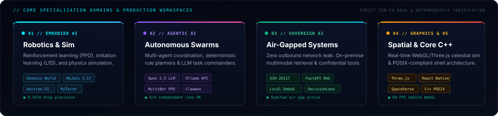

<!-- HERO BANNER -->
<a href="#-flagship-engineering-projects">
  <picture>
    <source media="(prefers-color-scheme: dark)" srcset="assets/hero-banner.svg">
    <source media="(prefers-color-scheme: light)" srcset="assets/hero-banner.svg">
    
  </picture>
</a>

  

<!-- DYNAMIC TYPING SVG -->

 

<!-- STATUS & TELEMETRY BADGES -->

  
  
  
  

<!-- QUICK NAVIGATION -->

  <a href="#-about-me--architectural-thesis"><b>Architecture</b></a>　·　
  <a href="#-core-engineering-domains"><b>Domains</b></a>　·　
  <a href="#-flagship-engineering-projects"><b>Flagship Projects</b></a>　·　
  <a href="#-technical-arsenal"><b>Arsenal</b></a>　·　
  <a href="#-github-telemetry--activity"><b>Telemetry</b></a>　·　
  <a href="#-launch-3d-interactive-portfolio"><b>3D Portfolio</b></a>　·　
  <a href="#-connect--collaborate"><b>Connect</b></a>

## 🛰️ About Me & Architectural Thesis

I am **Krishna Chaitanya**, a Computer Science student at **Scaler School of Technology** & **BITS Pilani**, engineering systems at the convergence of **Embodied AI, Reinforcement Learning, and Local-First Agentic Architectures**.

### Engineering Philosophy
* 🔬 **Beyond Wrapper APIs:** Rather than orchestrating API calls to proprietary cloud endpoints, I focus on local-first computation, training RL agents with custom physics environments, and benchmarking models running directly on consumer silicon.
* 🤖 **Embodiment & Physics-Driven AI:** From training heterogeneous multi-bot swarms to deliver 7 kg payloads in **Genesis World** to teleoperating a 23-DoF **Unitree G1 Humanoid** with Learning from Demonstration (LfD) in **MuJoCo 3.17**, I treat physical simulation as the crucible for real-world intelligence.
* 🛡️ **Air-Gapped Sovereignty:** Enterprise AI demands absolute confidential integrity. I design end-to-end air-gapped workbenches with multimodal open-weight LLMs, local vector indices, and zero outbound network transmission.
* 🪐 **Spatial Intuition & Systems:** I build phone-first 3D physics sandboxes using **Three.js** / **Expo** and engineer low-level systems like a **POSIX-compliant C++ shell** to master the entire compute stack.

  

## ⚡ Core Engineering Domains

  

 

<table>
  <tr>
    <td width="50%" valign="top">
      <h3>🤖 01 · Embodied AI & Humanoid Robotics</h3>
      <ul>
        <li><b>Physics Engines:</b> Genesis World v1.4.5, MuJoCo 3.17, PyTorch.</li>
        <li><b>Policy Optimization:</b> Proximal Policy Optimization (PPO), trajectory demonstrations, and inverse kinematics.</li>
        <li><b>Hardware Targets:</b> Unitree G1 Humanoid, heterogeneous warehouse rovers, drone simulation environments.</li>
      </ul>
    </td>
    <td width="50%" valign="top">
      <h3>🧠 02 · Autonomous Swarms & Local Planners</h3>
      <ul>
        <li><b>Local LLM Commanders:</b> Qwen 2.5 (1.5B/7B) and Llama runtimes executing real-time planning over learned physical skills.</li>
        <li><b>Multi-Agent Runtimes:</b> Collaborative workspaces with shared memory boards, deterministic rule arbitration, and independent verification.</li>
        <li><b>Air-Gap RAG:</b> Local vector stores, zero-latency embeddings, and privacy-preserving tool invocation.</li>
      </ul>
    </td>
  </tr>
  <tr>
    <td width="50%" valign="top">
      <h3>🛡️ 03 · Sovereign Air-Gapped Workbenches</h3>
      <ul>
        <li><b>Industrial AI (SIH26117):</b> Built for confidential refinery workflows; inference, embeddings, and tools run 100% on-device.</li>
        <li><b>Network Sandboxing:</b> Strict OS-level outbound socket blocking and cryptographically audited command execution.</li>
        <li><b>Organizational Memory:</b> Turning developer conversations into structured knowledge graphs via Supermemory Local.</li>
      </ul>
    </td>
    <td width="50%" valign="top">
      <h3>🪐 04 · Interactive 3D & Core Systems</h3>
      <ul>
        <li><b>Spatial Graphics:</b> Three.js, React Three Fiber, Expo, and WebGL celestial gravitational simulation.</li>
        <li><b>Systems Programming:</b> POSIX-compliant C++ shell (piping, redirection, fork/exec, process signal handling).</li>
        <li><b>Full-Stack Architecture:</b> TypeScript, React, Next.js, FastAPI, Node.js, and high-performance WebSockets.</li>
      </ul>
    </td>
  </tr>
</table>

  

## 🚀 Flagship Engineering Projects

<table>
  <!-- ROW 1 -->
  <tr>
    <td width="50%" valign="top">
      

        
        <h3>🤖 MultiBot-PPO (Swarm Robotics)</h3>
        
<b>Heterogeneous robot team pushing 7 kg crates into a delivery zone, orchestrated by a local LLM commander and learned PPO skills.</b>

        <ul>
          <li><b>Physics Simulation:</b> Built on Genesis World v1.4.5; trained on Apple M4 silicon with deterministic frame steps.</li>
          <li><b>Measured Benchmark:</b> Delivered 2 of 2 packages across 4 independent test runs with measured drop distances of <b>0.549 m</b> and <b>0.547 m</b> against a 0.55 m zone.</li>
          <li><b>Stack:</b> <code>Python 3.12</code> · <code>Genesis World</code> · <code>PPO</code> · <code>PyTorch</code> · <code>Qwen2.5 (Ollama)</code></li>
        </ul>
        

          
        

      

    </td>
    <td width="50%" valign="top">
      

        
        <h3>🦾 Humanoid-LfD (Unitree G1)</h3>
        
<b>Teaching a 23-DoF Unitree G1 humanoid robot manipulation and bipedal behaviors using Learning from Demonstration (LfD).</b>

        <ul>
          <li><b>Simulation Platform:</b> High-fidelity physical simulation in MuJoCo 3.17 with trajectory replay and inverse kinematics.</li>
          <li><b>Industrial Challenge:</b> Engineered for the <i>Teach a Humanoid With Your Own Hands</i> challenge (Awign × Armature AI Labs).</li>
          <li><b>Stack:</b> <code>PyTorch</code> · <code>MuJoCo 3.17</code> · <code>Python 3.12</code> · <code>Robotics Kinematics</code></li>
        </ul>
        

          
        

      

    </td>
  </tr>

  <!-- ROW 2 -->
  <tr>
    <td width="50%" valign="top">
      

        
        <h3>🛡️ Sovereign Agentic AI Workbench</h3>
        
<b>Air-gapped on-premise agentic AI workbench using open-weight multimodal LLMs for confidential industrial environments (SIH26117).</b>

        <ul>
          <li><b>Zero Data Leakage:</b> All LLM inference, vector embeddings, document generation, and tools run on the local machine with outbound traffic blocked.</li>
          <li><b>Problem Origin:</b> Mangalore Refinery and Petrochemicals Limited industrial specifications.</li>
          <li><b>Stack:</b> <code>Python</code> · <code>Ollama</code> · <code>FastAPI</code> · <code>Local RAG</code> · <code>Docker</code></li>
        </ul>
        

          
        

      

    </td>
    <td width="50%" valign="top">
      

        
        <h3>🪐 SpaceVerse (Celestial Simulation)</h3>
        
<b>Phone-first interactive 3D astronomy and gravitational physics sandbox with real-time planetary parameters.</b>

        <ul>
          <li><b>3D Engine:</b> Fluid 60 FPS celestial rendering using <code>@react-three/fiber/native</code> and Three.js shader pipelines on mobile.</li>
          <li><b>Physics Sandbox:</b> Dynamic experimentation with planetary mass, orbital radius, velocity vectors, and gravitational forces.</li>
          <li><b>Stack:</b> <code>TypeScript</code> · <code>React Native</code> · <code>Expo</code> · <code>Three.js</code> · <code>R3F</code></li>
        </ul>
        

          
        

      

    </td>
  </tr>

  <!-- ROW 3 -->
  <tr>
    <td width="50%" valign="top">
      

        
        <h3>🧠 DecisionLens</h3>
        
<b>Continuous architectural memory platform turning developer conversations, Slack discussions, and PRs into searchable evidence.</b>

        <ul>
          <li><b>Architectural Intelligence:</b> Detects recurring technical friction, surfaces rationale behind historical decisions, and maps dependencies.</li>
          <li><b>Local Memory:</b> Powered by Supermemory Local integration for zero-cloud exposure.</li>
          <li><b>Stack:</b> <code>React</code> · <code>TypeScript</code> · <code>FastAPI</code> · <code>Supermemory</code> · <code>Vector Graph</code></li>
        </ul>
        

          
        

      

    </td>
    <td width="50%" valign="top">
      

        
        <h3>💻 Custom POSIX Shell in C++</h3>
        
<b>POSIX-compliant shell architecture built from scratch in modern C++ with command parsing, pipelines, and redirection.</b>

        <ul>
          <li><b>Low-Level Systems:</b> Implemented tokenizer, AST command evaluation, fork/exec pipelines, path resolution, and shell builtins.</li>
          <li><b>CodeCrafters Challenge:</b> Rigorously validated against POSIX standard conformance test suites.</li>
          <li><b>Stack:</b> <code>C++17</code> · <code>POSIX API</code> · <code>Linux Syscalls</code> · <code>Process IPC</code></li>
        </ul>
        

          
        

      

    </td>
  </tr>
</table>

  

## 🛠️ Technical Arsenal

### 🤖 Embodied AI, Robotics & Machine Learning

  
  
  
  
  
  
  
  

### 💻 Languages & Core Systems

  
  
  
  
  
  
  

### 🎨 Spatial Computing, Frontend & Backend Runtimes

  
  
  
  
  
  
  

### 🛡️ Infrastructure, Tooling & Verification

  
  
  
  
  

  

## 📊 GitHub Telemetry & Activity

<!-- ROW 1: CORE STATS & STREAK -->
<table border="0">
  <tr>
    <td align="center" valign="middle">
      
    </td>
    <td align="center" valign="middle">
      
    </td>
  </tr>
</table>

 

<!-- ROW 2: TOP LANGUAGES & ACTIVITY GRAPH -->
<table border="0">
  <tr>
    <td align="center" valign="middle">
      
    </td>
    <td align="center" valign="middle">
      
    </td>
  </tr>
</table>

  

## 🌌 Interactive 3D Portfolio Experience

> As a complement to this GitHub visual identity, I maintain an **interactive 3D developer portfolio** with real-time Three.js spatial physics, particle field shaders, and interactive project modules.

   
  
    
  Interactive WebGL Canvas · Spatial Raycasting · Real-Time Shader Physics

  

## 🔬 Current Research & Engineering Frontiers

* 🏃 **Sim-to-Real Locomotion Transfer:** Investigating domain randomization and privileged teacher-student policy distillation in MuJoCo for robust bipedal walking over uneven terrains.
* 🧩 **Multi-Agent Decision Determinism:** Formalizing verification loops where local LLM planners generate structured JSON task specifications executed and validated by physics-bounded controllers.
* ⚡ **High-Throughput Local Inference:** Profiling token generation latency and KV cache memory bandwidth across unified Apple Silicon architectures for sub-millisecond robotic control loops.

  

## 📡 Connect & Collaborate

  
  &nbsp;
  
  &nbsp;
  

 

<!-- FOOTER SIGNATURE -->

