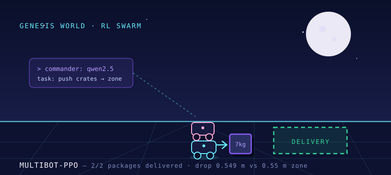
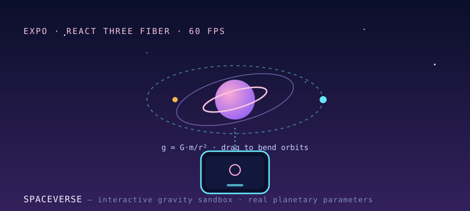
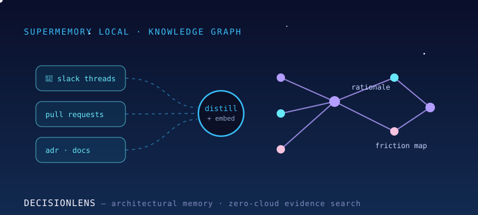
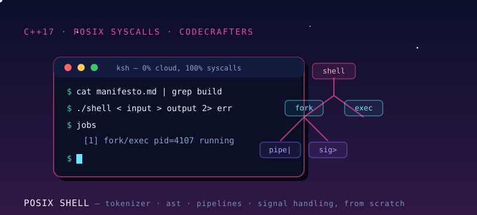

<!-- ═══════════ HERO ═══════════ -->
<a href="#-flagship-engineering-projects">
  <picture>
    <source media="(prefers-color-scheme: dark)" srcset="assets/v7/hero-banner.svg">
    <source media="(prefers-color-scheme: light)" srcset="assets/v7/hero-banner.svg">
    
  </picture>
</a>

  

<!-- DYNAMIC TYPING -->

 

<!-- STATUS TELEMETRY -->

  
  
  
  

<!-- NAVIGATION -->

  <a href="#-about-me--the-conviction"><b>🔭 About</b></a>　·　
  <a href="#-core-engineering-domains"><b>🧭 Domains</b></a>　·　
  <a href="#-flagship-engineering-projects"><b>🚀 Projects</b></a>　·　
  <a href="#-technical-arsenal"><b>🛠️ Arsenal</b></a>　·　
  <a href="#-github-telemetry"><b>📊 Telemetry</b></a>　·　
  <a href="#-current-research--frontiers"><b>🔬 Research</b></a>　·　
  <a href="#-connect--collaborate"><b>📡 Connect</b></a>

## 🔭 About Me — The Conviction

I'm **Krishna Chaitanya**, a computer science student at **Scaler School of Technology & BITS Pilani**, engineering at the intersection of **embodied AI, reinforcement learning, and local-first agentic systems**.

My operating thesis: *real intelligence is forged in physics.* I train policies inside simulators, command them with language models that run **on my own machine**, and I don't ship a number I haven't measured.

* 🔬 **Beyond wrapper APIs** — I build custom physics environments and train RL agents from scratch, then benchmark open-weight models directly on consumer silicon.
* 🤖 **Embodiment first** — from teleoperating a 23-DoF **Unitree G1** humanoid with Learning from Demonstration in MuJoCo, to heterogeneous robot swarms delivering real payloads in Genesis World.
* 🛡️ **Air-gapped sovereignty** — confidential AI workbenches where every token, embedding, and tool call stays on-device. Zero outbound traffic, by design.
* 🪐 **Full-stack curiosity** — POSIX-compliant C++ shells, WebGL celestial sandboxes, and everything in between. The whole compute stack is the playground.

## 🧭 Core Engineering Domains

  

 

<table>
  <tr>
    <td width="50%" valign="top">
      <h3>🤖 01 · Embodied AI & Humanoid Robotics</h3>
      <ul>
        <li><b>Physics Engines:</b> Genesis World v1.4.5, MuJoCo 3.17, PyTorch.</li>
        <li><b>Policy Optimization:</b> Proximal Policy Optimization, trajectory demonstrations, inverse kinematics.</li>
        <li><b>Hardware Targets:</b> Unitree G1 humanoid, heterogeneous warehouse rovers, drone simulation.</li>
      </ul>
    </td>
    <td width="50%" valign="top">
      <h3>🧠 02 · Autonomous Swarms & Local Planners</h3>
      <ul>
        <li><b>Local LLM Commanders:</b> Qwen 2.5 (1.5B/7B) + Llama runtimes planning over learned physical skills in real time.</li>
        <li><b>Multi-Agent Runtimes:</b> Shared memory boards, deterministic rule arbitration, independent verification.</li>
        <li><b>Air-Gap RAG:</b> Local vector stores, zero-latency embeddings, privacy-preserving tool invocation.</li>
      </ul>
    </td>
  </tr>
  <tr>
    <td width="50%" valign="top">
      <h3>🛡️ 03 · Sovereign Air-Gapped Workbenches</h3>
      <ul>
        <li><b>Industrial AI (SIH26117):</b> Built for confidential refinery workflows — inference, embeddings, tools run 100% on-device.</li>
        <li><b>Network Sandboxing:</b> Strict OS-level outbound socket blocking, cryptographically audited command execution.</li>
        <li><b>Organizational Memory:</b> Developer conversations → structured knowledge graphs via Supermemory Local.</li>
      </ul>
    </td>
    <td width="50%" valign="top">
      <h3>🪐 04 · Interactive 3D & Core Systems</h3>
      <ul>
        <li><b>Spatial Graphics:</b> Three.js, React Three Fiber, Expo, WebGL celestial gravitational simulation.</li>
        <li><b>Systems Programming:</b> POSIX-compliant C++ shell — piping, redirection, fork/exec, signal handling.</li>
        <li><b>Full-Stack Architecture:</b> TypeScript, React, Next.js, FastAPI, Node.js, high-performance WebSockets.</li>
      </ul>
    </td>
  </tr>
</table>

## 🚀 Flagship Engineering Projects

<table>
  <!-- ROW 1 -->
  <tr>
    <td width="50%" valign="top">
      

        
        <h3>🤖 MultiBot-PPO (Swarm Robotics)</h3>
        
<b>Heterogeneous robot team pushing 7 kg crates into a delivery zone, orchestrated by a local LLM commander and learned PPO skills.</b>

        <ul>
          <li><b>Physics Simulation:</b> Genesis World v1.4.5, trained on Apple M4 silicon with deterministic frame steps.</li>
          <li><b>Measured Benchmark:</b> Delivered <b>2/2 packages</b> across 4 independent runs — drop distances <b>0.549 m / 0.547 m</b> against a 0.55 m zone.</li>
          <li><b>Stack:</b> <code>Python 3.12</code> · <code>Genesis World</code> · <code>PPO</code> · <code>PyTorch</code> · <code>Qwen2.5 (Ollama)</code></li>
        </ul>
        

          
        

      

    </td>
    <td width="50%" valign="top">
      

        
        <h3>🦾 Humanoid-LfD (Unitree G1)</h3>
        
<b>Teaching a 23-DoF Unitree G1 humanoid manipulation and bipedal behaviors using Learning from Demonstration.</b>

        <ul>
          <li><b>Simulation Platform:</b> High-fidelity MuJoCo 3.17 with trajectory replay and inverse kinematics.</li>
          <li><b>Industrial Challenge:</b> Engineered for <i>Teach a Humanoid With Your Own Hands</i> (Awign × Armature AI Labs).</li>
          <li><b>Stack:</b> <code>PyTorch</code> · <code>MuJoCo 3.17</code> · <code>Python 3.12</code> · <code>Robotics Kinematics</code></li>
        </ul>
        

          
        

      

    </td>
  </tr>

  <!-- ROW 2 -->
  <tr>
    <td width="50%" valign="top">
      

        
        <h3>🛡️ Sovereign Agentic AI Workbench</h3>
        
<b>Air-gapped on-premise agentic AI workbench with open-weight multimodal LLMs for confidential industrial environments (SIH26117).</b>

        <ul>
          <li><b>Zero Data Leakage:</b> All inference, embeddings, document generation, and tools run locally — outbound traffic blocked.</li>
          <li><b>Problem Origin:</b> Mangalore Refinery and Petrochemicals Limited industrial specifications.</li>
          <li><b>Stack:</b> <code>Python</code> · <code>Ollama</code> · <code>FastAPI</code> · <code>Local RAG</code> · <code>Docker</code></li>
        </ul>
        

          
        

      

    </td>
    <td width="50%" valign="top">
      

        
        <h3>🪐 SpaceVerse (Celestial Simulation)</h3>
        
<b>Phone-first interactive 3D astronomy and gravitational physics sandbox with real-time planetary parameters.</b>

        <ul>
          <li><b>3D Engine:</b> Fluid 60 FPS celestial rendering via <code>@react-three/fiber/native</code> and Three.js shader pipelines on mobile.</li>
          <li><b>Physics Sandbox:</b> Live experimentation with planetary mass, orbital radius, velocity vectors, gravity.</li>
          <li><b>Stack:</b> <code>TypeScript</code> · <code>React Native</code> · <code>Expo</code> · <code>Three.js</code> · <code>R3F</code></li>
        </ul>
        

          
        

      

    </td>
  </tr>

  <!-- ROW 3 -->
  <tr>
    <td width="50%" valign="top">
      

        
        <h3>🧠 DecisionLens</h3>
        
<b>Continuous architectural memory turning developer conversations, Slack discussions, and PRs into searchable evidence.</b>

        <ul>
          <li><b>Architectural Intelligence:</b> Detects recurring friction, surfaces historical rationale, maps dependencies.</li>
          <li><b>Local Memory:</b> Supermemory Local integration — zero cloud exposure.</li>
          <li><b>Stack:</b> <code>React</code> · <code>TypeScript</code> · <code>FastAPI</code> · <code>Supermemory</code> · <code>Vector Graph</code></li>
        </ul>
        

          
        

      

    </td>
    <td width="50%" valign="top">
      

        
        <h3>💻 Custom POSIX Shell in C++</h3>
        
<b>POSIX-compliant shell built from scratch in modern C++ — parsing, pipelines, redirection, signals.</b>

        <ul>
          <li><b>Low-Level Systems:</b> Tokenizer, AST command evaluation, fork/exec pipelines, path resolution, builtins.</li>
          <li><b>CodeCrafters Challenge:</b> Validated against POSIX conformance test suites.</li>
          <li><b>Stack:</b> <code>C++17</code> · <code>POSIX API</code> · <code>Linux Syscalls</code> · <code>Process IPC</code></li>
        </ul>
        

          
        

      

    </td>
  </tr>
</table>

## 🛠️ Technical Arsenal

### 🤖 Embodied AI, Robotics & ML

  
  
  
  
  
  
  
  

### 💻 Languages & Core Systems

  
  
  
  
  
  
  

### 🎨 Spatial Computing & Full-Stack Runtimes

  
  
  
  
  
  

### 🛡️ Infrastructure, Tooling & Verification

  
  
  
  
  

## 📊 GitHub Telemetry

<table border="0">
  <tr>
    <td align="center" valign="middle">
      
    </td>
    <td align="center" valign="middle">
      
    </td>
  </tr>
</table>

 

<table border="0">
  <tr>
    <td align="center" valign="middle">
      
    </td>
    <td align="center" valign="middle">
      
    </td>
  </tr>
</table>

## 🌌 Interactive 3D Portfolio Experience

> Complementing this identity: an **interactive WebGL portfolio** with real-time Three.js spatial physics, particle shader fields, and interactive project modules.

   
  
  &nbsp;
  
    
  WebGL canvas · spatial raycasting · real-time shader physics · zero build step

## 🔬 Current Research & Frontiers

  

 

* 🏃 **Sim-to-Real Locomotion Transfer:** domain randomization and privileged teacher–student policy distillation in MuJoCo for robust bipedal walking over uneven terrain.
* 🧩 **Multi-Agent Decision Determinism:** verification loops where local LLM planners emit structured JSON task specs, executed and validated by physics-bounded controllers.
* ⚡ **High-Throughput Local Inference:** profiling token latency and KV-cache memory bandwidth on unified Apple Silicon for sub-millisecond robotic control loops.

## 📡 Connect & Collaborate

  
  &nbsp;
  
  &nbsp;
  

 

