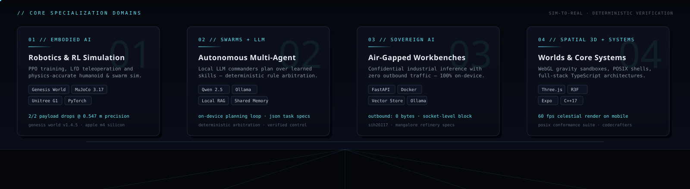
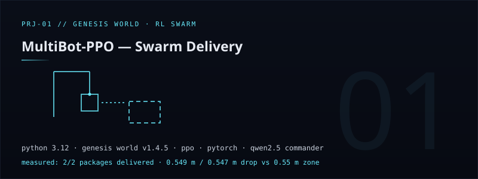
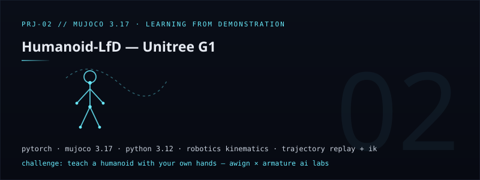
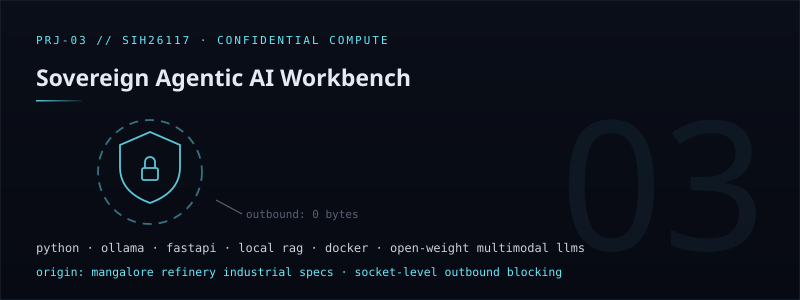
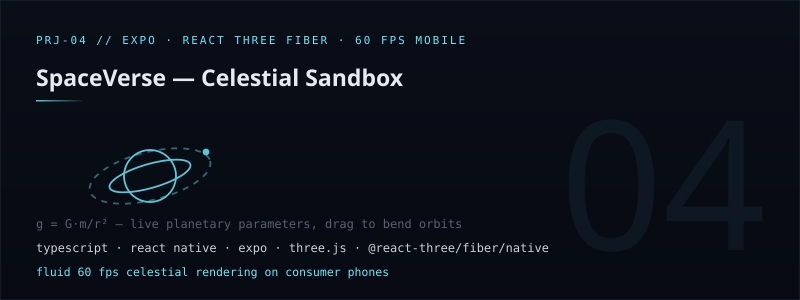
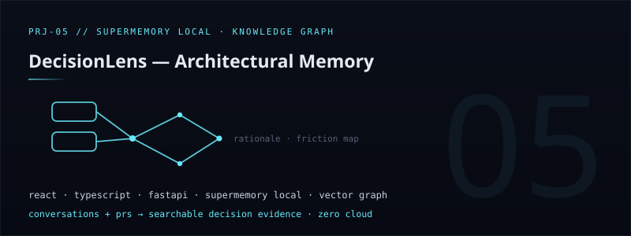
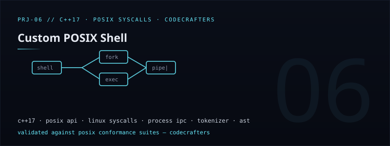

<!-- ═══════════ 00 · HERO ═══════════ -->
<a href="#03--selected-projects">
  <picture>
    <source media="(prefers-color-scheme: dark)" srcset="assets/v8/hero.svg">
    <source media="(prefers-color-scheme: light)" srcset="assets/v8/hero.svg">
    
  </picture>
</a>

 

 

  <a href="#01--about"><b>01</b> about</a>　·　
  <a href="#02--core-domains"><b>02</b> domains</a>　·　
  <a href="#03--selected-projects"><b>03</b> projects</a>　·　
  <a href="#06--research-frontiers"><b>06</b> research</a>　·　
  <a href="#08--contact"><b>08</b> contact</a>

## 01 — About

I'm **Krishna Chaitanya**, a computer science student at **Scaler School of Technology & BITS Pilani**, working at the intersection of embodied AI, reinforcement learning, and local-first agentic systems.

My operating thesis: *real intelligence is forged in physics.* I train policies inside simulators, command them with language models that run on my own machine, and I don't ship a number I haven't measured. Every claim on this page is tied to a benchmark, a dataset, or a conformance suite.

## 02 — Core Domains

  

 

<table>
  <tr>
    <td width="50%" valign="top">
      <h3>01 · Embodied AI & Humanoid Robotics</h3>
      <ul>
        <li>Physics: Genesis World v1.4.5, MuJoCo 3.17, PyTorch.</li>
        <li>Methods: Proximal Policy Optimization, Learning from Demonstration, inverse kinematics.</li>
        <li>Targets: Unitree G1 humanoid, heterogeneous warehouse rovers, drone simulation.</li>
      </ul>
    </td>
    <td width="50%" valign="top">
      <h3>02 · Autonomous Swarms & Local Planners</h3>
      <ul>
        <li>Local LLM commanders (Qwen 2.5, Llama) planning over learned physical skills in real time.</li>
        <li>Shared memory boards, deterministic rule arbitration, independent verification.</li>
        <li>Air-gapped RAG: local vector stores, privacy-preserving tool invocation.</li>
      </ul>
    </td>
  </tr>
  <tr>
    <td width="50%" valign="top">
      <h3>03 · Sovereign Air-Gapped Workbenches</h3>
      <ul>
        <li>Industrial AI (SIH26117): confidential refinery workflows, 100% on-device inference.</li>
        <li>OS-level outbound socket blocking, cryptographically audited command execution.</li>
        <li>Organizational memory via Supermemory Local knowledge graphs.</li>
      </ul>
    </td>
    <td width="50%" valign="top">
      <h3>04 · Interactive 3D & Core Systems</h3>
      <ul>
        <li>Spatial graphics: Three.js, React Three Fiber, Expo, WebGL gravitational simulation.</li>
        <li>Systems: POSIX-compliant C++ shell — pipelines, redirection, fork/exec, signals.</li>
        <li>Full-stack: TypeScript, React, Next.js, FastAPI, Node.js, WebSockets.</li>
      </ul>
    </td>
  </tr>
</table>

## 03 — Selected Projects

<table>
  <tr>
    <td width="50%" valign="top">
      

        
        <ul>
          <li><b>Problem:</b> coordinate a heterogeneous robot team to deliver real payloads without a cloud planner.</li>
          <li><b>Approach:</b> PPO skills trained in Genesis World, commanded by a local Qwen 2.5 planner on Apple M4.</li>
          <li><b>Result:</b> 2/2 packages delivered across 4 independent runs — 0.549 m / 0.547 m drops against a 0.55 m zone.</li>
        </ul>
        

          
        

      

    </td>
    <td width="50%" valign="top">
      

        
        <ul>
          <li><b>Problem:</b> transfer human manipulation demonstrations to a 23-DoF bipedal platform.</li>
          <li><b>Approach:</b> trajectory replay and inverse kinematics in MuJoCo 3.17, high-fidelity sim-first pipeline.</li>
          <li><b>Result:</b> reproducible demonstration-to-execution pipeline for the Awign × Armature AI Labs challenge.</li>
        </ul>
        

          
        

      

    </td>
  </tr>
  <tr>
    <td width="50%" valign="top">
      

        
        <ul>
          <li><b>Problem:</b> enterprises need agentic AI that never leaks confidential documents.</li>
          <li><b>Approach:</b> open-weight multimodal LLMs, local RAG and tools on-device; outbound traffic blocked at socket level.</li>
          <li><b>Result:</b> a working air-gapped workbench built against Mangalore Refinery (MRPL) industrial specifications.</li>
        </ul>
        

          
        

      

    </td>
    <td width="50%" valign="top">
      

        
        <ul>
          <li><b>Problem:</b> interactive orbital physics usually dies on mobile hardware.</li>
          <li><b>Approach:</b> Three.js shader pipelines through @react-three/fiber/native on Expo, tuned for 60 FPS.</li>
          <li><b>Result:</b> phone-first gravitational sandbox with live planetary mass, radius and velocity parameters.</li>
        </ul>
        

          
        

      

    </td>
  </tr>
  <tr>
    <td width="50%" valign="top">
      

        
        <ul>
          <li><b>Problem:</b> architectural decisions evaporate across Slack threads and PR discussions.</li>
          <li><b>Approach:</b> continuous distillation into a searchable decision graph via Supermemory Local — zero cloud.</li>
          <li><b>Result:</b> surfacing of recurring technical friction, historical rationale and dependency maps on demand.</li>
        </ul>
        

          
        

      

    </td>
    <td width="50%" valign="top">
      

        
        <ul>
          <li><b>Problem:</b> understand what a shell actually is — beneath the convenience of bash, down to the syscalls.</li>
          <li><b>Approach:</b> tokenizer, AST evaluation, fork/exec pipelines, path resolution, builtins and signal handling in C++17.</li>
          <li><b>Result:</b> shell validated against POSIX conformance suites via the CodeCrafters track.</li>
        </ul>
        

          
        

      

    </td>
  </tr>
</table>

## 04 — Technical Arsenal

**languages**

  
  
  
  
  
  

**ai & simulation**

  
  
  
  
  
  

**spatial & infrastructure**

  
  
  
  
  
  
  

## 05 — Telemetry

<table border="0">
  <tr>
    <td align="center" valign="middle">
      
    </td>
    <td align="center" valign="middle">
      
    </td>
  </tr>
</table>

## 06 — Research Frontiers

  

 

* **Sim-to-Real Locomotion Transfer** — domain randomization and privileged teacher–student policy distillation in MuJoCo for robust bipedal walking over uneven terrain.
* **Multi-Agent Decision Determinism** — verification loops where local LLM planners emit structured JSON task specs, executed and validated by physics-bounded controllers.
* **High-Throughput Local Inference** — profiling token latency and KV-cache memory bandwidth on unified Apple Silicon memory for sub-millisecond robotic control loops.

## 07 — Interactive 3D Portfolio

An interactive WebGL complement to this index — real-time Three.js spatial physics, particle shader fields and interactive project modules.

   
  <a href="https://saichaitu2012.github.io/SAICHAITU2012/"><b>launch the 3d portfolio →</b></a>
   
  webgl canvas · spatial raycasting · real-time shader physics · zero build step

## 08 — Contact

open to collaborations, research problems and interesting systems work

  <b><a href="https://github.com/SAICHAITU2012">github — SAICHAITU2012</a></b>
  ·
  <b><a href="mailto:krishnachaitanya413710@gmail.com">krishnachaitanya413710@gmail.com</a></b>
  ·
  <b><a href="https://github.com/SAICHAITU2012?tab=repositories">repository archive</a></b>

 

